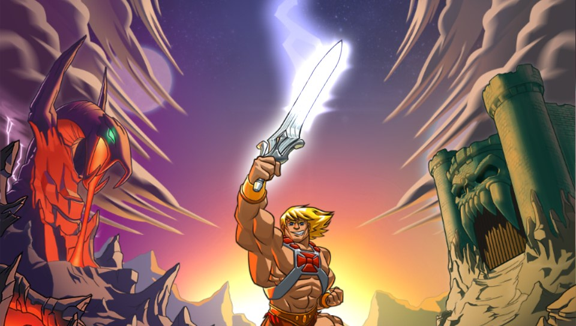
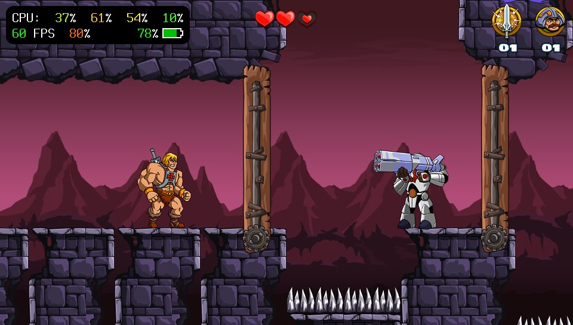
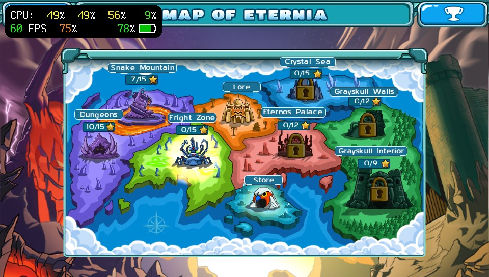
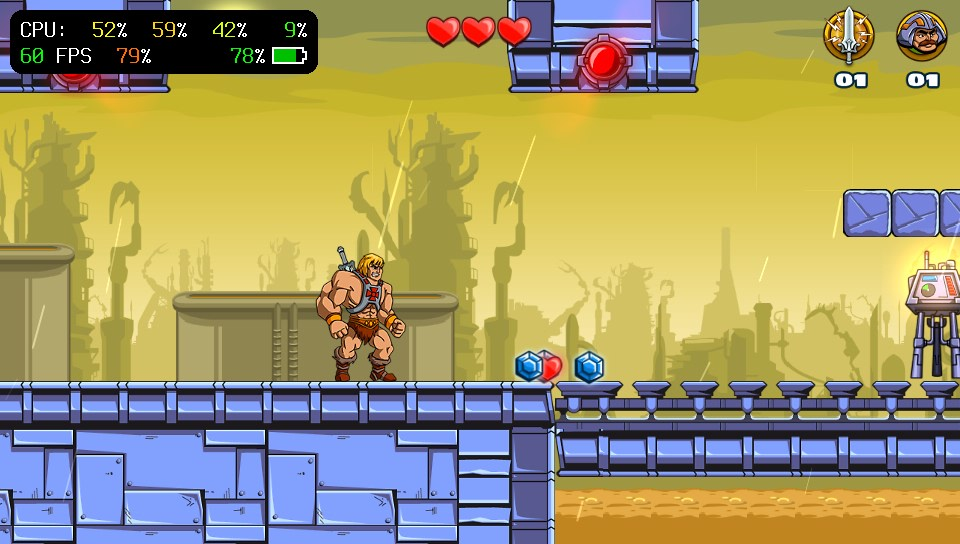

# He-Man Vita

<p align="center"></p>

This is a wrapper/port of <b>He-Man: The Most Powerful Game in the Universe</b> for the *PS Vita*.

The port works by loading the official Android ARMv7 executables in memory, resolving its imports with native functions and patching it in order to properly run.
By doing so, it's basically as if we emulate a minimalist Android environment in which we run natively the executable as is.

<p align="center">
  
  
  
</p>

## Changelog

### v.1.0

- Initial release.
- Physical controls: left stick / D-pad to move, face buttons mapped to the game's touch actions and R for "I Have The Power".
- Game runs locked at 60 FPS (the game's own frame timer was patched, it was running at 58.8 FPS out of sync with the display).
- Greatly reduced loading times (about a third of the original) thanks to RAM file caches, an optional asset pack and faster reading of the game's data files.
- Fixed crashes that don't happen on Android (music streaming race when leaving a level, overflow in the engine's string buffers).

## Notes and Tips

- Controls can be remapped by editing `ux0:data/heman/controls.txt`, which is created on first launch. Each line binds a button to a touch on the 960x544 screen: `<BUTTON> tap x y`, `<BUTTON> swipe x1 y1 x2 y2` or `<BUTTON> ihtp` (I Have The Power).
- Default controls:

| Vita | Action |
|---|---|
| Left stick / D-pad | Move |
| Cross | Swipe up (jump) |
| Square | Tap (attack) |
| Circle / L | Swipe right / left |
| Triangle | Top-right on-screen button |
| R | I Have The Power |
| Start | Top-left on-screen button (pause) |

- The asset pack `heman.pak` is optional, but without it loading takes noticeably longer.

## Setup Instructions (For End Users)

In order to properly install the game, you'll have to follow these steps precisely:

- Install [kubridge](https://github.com/bythos14/kubridge/releases/) by copying `kubridge.skprx` to your taiHEN plugins folder (usually `ux0:tai`) and adding an entry to your `config.txt` under `*KERNEL`:

```
  *KERNEL
  ux0:tai/kubridge.skprx
```

- Install `libshacccg.suprx`, if you don't have it already, by following [this guide](https://samilops2.gitbook.io/vita-troubleshooting-guide/shader-compiler/extract-libshacccg.suprx).
- Obtain your copy of *He-Man: The Most Powerful Game in the Universe v1.0.3* legally for Android in form of an `.apk` file and an obb (`main.obb`). [You can get all the required files directly from your phone](https://stackoverflow.com/questions/11012976/how-do-i-get-the-apk-of-an-installed-app-without-root-access) or by using an apk extractor you can find in the play store.
- Open the apk with your zip explorer and extract `lib/armeabi-v7a/libnative-activity.so` to `ux0:data/heman`.
- From the same apk, extract the `assets` folder to `ux0:data/heman` (so you get `ux0:data/heman/assets`).
- The obb is a zip file too: open it with your zip explorer (eg. 7-Zip) and extract all its content in `ux0:data/heman` (so you get `ux0:data/heman/screen-large`, `ux0:data/heman/sounds`, ...).
- **Optional (recommended)**: Create the asset pack for faster loading. On your PC, with [Python 3](https://www.python.org/downloads/) installed, run `python3 tools/make_pak.py main.obb heman.pak` from this repository and copy `heman.pak` to `ux0:data/heman`. Keep the files extracted in the previous step, they are still needed. If you ever change your obb, create the pack again.
- Install the `heman.vpk` from the Release page.

## Build Instructions (For Developers)

In order to build the loader, you'll need a [vitasdk](https://github.com/vitasdk) build fully compiled with softfp usage.

The required libraries ([so_util](https://github.com/Rinnegatamante/so_util), [FalsoJNI](https://github.com/v-atamanenko/FalsoJNI), [FalsoNDK](https://github.com/elliencode/FalsoNDK) and [vitaGL](https://github.com/Rinnegatamante/vitaGL)) are included in the `lib` folder with the small fixes this port needs, and vitaGL is built automatically.

After all these requirements are met, you can compile the loader with the following commands:

```bash
mkdir build && cd build
cmake .. && make
```

Optional CMake flags: `-DPERF_LOG=ON` writes frame timings and loading stalls to `ux0:data/heman/perf.txt`, `-DHEAP_WATCH=ON` enables heap corruption checks (slow) and `-DMSAA_4X=ON` enables 4x MSAA.

## Credits

- gl33ntwine (Volodymyr Atamanenko) for [soloader-boilerplate](https://github.com/v-atamanenko/soloader-boilerplate), the base this port was built on, and for [FalsoJNI](https://github.com/v-atamanenko/FalsoJNI).
- TheFloW for the original .so loader.
- Rinnegatamante for [so_util](https://github.com/Rinnegatamante/so_util) and [vitaGL](https://github.com/Rinnegatamante/vitaGL).
- elliencode for [FalsoNDK](https://github.com/elliencode/FalsoNDK) and the [NBA Jam port](https://github.com/elliencode/nba-jam-psv), used as reference.
- bythos14 for [kubridge](https://github.com/bythos14/kubridge).

## License

The port's code is released under the MIT license (see [LICENSE](LICENSE)), like the boilerplate it is based on. Bundled libraries keep their own licenses (vitaGL: LGPL-3.0, see `lib/vitagl/COPYING*`).
